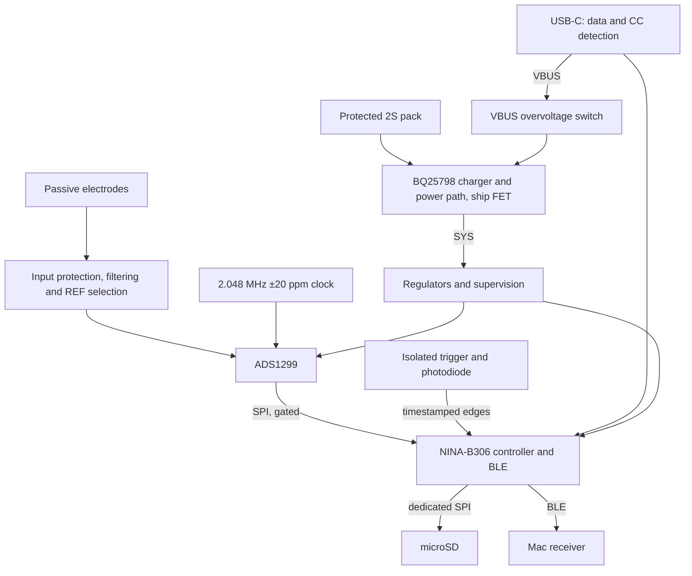

# EEG PCB design guide

Last updated: 2026-11-08 • Current schematic and board: Rev C11 (Step 14) • Status: bench candidate, placed but not routed

This guide describes the design as it currently stands: what is being built, how each part works and why the present choices were made. It assumes familiarity with laboratory measurement but not with specialist PCB or analogue-circuit design. The rationale behind individual choices, and the conditions for revisiting them, are recorded in [decision_log.md](decision_log.md). The step-by-step reviews in [reviews/](reviews/) hold the detailed calculations, manufacturer references and the history of how each subsystem reached its current form. The current status and open release gates are summarised in the [README](../README.md).

Throughout this guide, *drawn* means present in the schematic and checked for connectivity; it does not mean simulated, built or measured. Nothing in the design has been physically tested, and the board is not released for fabrication or for connection to a person.

## 1. Purpose and boundaries

The board is a portable EEG acquisition system for long-term electrode research, in particular for comparing PEDOT:PSS-based electrodes with commercial Ag/AgCl electrodes. Adjacent electrode pairs can be recorded simultaneously, which reduces the temporal differences between recordings; electrode position and reference choice still affect the comparison.

The system records locally to microSD whilst streaming over BLE to an M2 Mac. It must preserve raw measurements, electrode and montage metadata and accurate event timing, so that electrode performance can be evaluated without being confounded by failures of the recording system.

| Target | Current meaning |
|---|---|
| Eight channels | Eight simultaneous differential measurements, not eight independent grounds |
| 24 bit, 1 kS/s | Raw conversion format and sampling rate; not a claim of 24 noise-free bits |
| 0.1–100 Hz | Intended analysis band, not a completed analogue filter specification |
| Passive electrodes | No powered buffer at each electrode |
| 24 h | Continuous local recording plus BLE; a target, not demonstrated endurance |
| BLE range | ≈ 2 m to the Mac |
| Events | Isolated external trigger and photodiode timing, principally for visual ERP |
| PCB and enclosure | Four layers (JLC04161H-3313, 1.6 mm); 110 × 85 mm, all parts on top; 30 mm enclosure height target, pack beside the board |
| Budget | €500 including VAT, assembly, enclosure and storage; batteries and shipping excluded |

## 2. What exists now

Rev C11 is a 17-page KiCad project ([hardware/EEG_RevC.kicad_sch](../hardware/EEG_RevC.kicad_sch)) generated by [hardware/scripts/build.py](../hardware/scripts/build.py). It integrates the ADC and electrode inputs with a buffered shared reference, the BQ25798 charger and power path, the Step 4 power and supervision circuitry, the NINA-B306 controller module, USB-C data and current detection, SWD debug access, a microSD socket, an external ADC clock and the isolated trigger and photodiode inputs. Since Step 13 every fitted part has an exact manufacturer part number ([hardware/bom.csv](../hardware/bom.csv), costed in [hardware/bom_cost.csv](../hardware/bom_cost.csv)) and a footprint whose pads match its symbol pins; six footprints KiCad does not stock are generated from the manufacturers' drawings into `hardware/EEG.pretty`. Step 14 added a VBUS overvoltage switch and a placed, unrouted four-layer board ([hardware/EEG_RevC.kicad_pcb](../hardware/EEG_RevC.kicad_pcb)).

| Sheet | What it contains |
|---|---|
| ads1299 core | U1 (ADS1299), its supply pins, VREF and VCAP capacitors |
| Electrode inputs 1–4 and 5–8 | Electrode leads (off-board symbols), series resistors, TVS protection, differential capacitors and REF-selection jumpers |
| Reference buffer and BIAS drive network | REF electrode protection and U500 (OPA376) REF buffer; BIAS feedback compensation, series resistors and clamp; J500 electrode harness connector |
| BQ25798 charger, power path and pack connector | U400 charger, Q400 ship FET (soft-off), J401 pack connector with NTC, POWER button, charge LED |
| analog | LT3045 analogue regulator (5.090 V); Q201 backfeed clamp that holds +5VA down while the rail is off |
| Persistent analogue restart latch (Step 10) | U226–U228: fault clears RUN_ARMED; restart needs a new RUN_REQUEST edge |
| supervision | TPS389001 voltage supervisors for analogue, digital, SYS and pack |
| reset logic | Hardware AND-gating of ADC reset and analogue enable |
| ADC startup gating and SPI connections | Output-enable buffers that hold ADC control lines low until power is valid; Y340 2.048 MHz ADC clock |
| NINA-B306 controller and reserved interfaces | U300 module and its pin allocation |
| SWD / buttons / hardware service inhibit | J300 debug connector, reset, recovery and record buttons, service interlock logic |
| USB-C device connector / ESD / CC current detection | J310, TUSB320LAI and USB ESD protection |
| Digital 3V3 rail | TPS62162 digital converter from SYS |
| microSD SPI and shutdown test access | J420 socket, series resistors, pull-ups, card detect and test pads |
| Isolated trigger input and photodiode front end | TLP2761 optocoupler input, photodiode amplifier, comparator and I²C threshold DAC |

Global net labels connect the sheets electrically, so two matching labels on different pages are connected without a drawn wire between them. Rendered SVG views of every sheet are in [hardware/preview/](../hardware/preview/).

All 16 electrodes, REF and BIAS reach the board through one keyed 2 × 10 box header, J500 (pins 1–16 CH1+ to CH8−, 17 REF, 18 BIAS); it carries no ground or supply. The design does not yet contain the mechanical service interlock, USB overvoltage protection or any acquisition firmware. There is no PCB layout.

## 3. Signal and power architecture

BIAS also feeds a controlled common-mode voltage back towards the body through its dedicated electrode and resistor network. The diagram omits that feedback path for clarity.

## 4. What an EEG input measures

A differential channel measures the voltage difference between two terminals:

\[
V_{diff}=V_P-V_N,\qquad V_{CM}=\frac{V_P+V_N}{2}.
\]

The EEG waveform is part of the differential voltage. Both electrodes can also pick up a much larger shared mains-related voltage, which the amplifier ideally rejects. Real circuits have finite common-mode rejection, and mismatched electrode impedances or input components convert part of the shared interference into differential error.

An electrode is not an ideal wire. A useful model includes a DC half-cell potential and a frequency-dependent interface impedance, often represented by resistive and capacitive elements. Dry or changing contacts show high impedance, motion-related voltage changes and variable offsets. A design can therefore have low noise with shorted inputs and still perform poorly with real electrodes.

### REF, BIAS and GND are different

| Term | Role |
|---|---|
| REF electrode | A measurement terminal shared by the channels that select it, through a unity-gain buffer |
| BIAS electrode | A driven feedback connection that controls body and input common-mode voltage |
| Circuit GND | Circuit voltage reference and return node; not protective earth |
| ADC voltage reference | Internal ≈ 4.5 V scale used by the converter; not the REF electrode |

For a bipolar channel the negative terminal goes to its own electrode; for a shared-reference channel it goes to REF_BUF, the buffered copy of the REF electrode. Jumpers JP1–JP8 make this selection per channel (1–2 bipolar, 2–3 shared REF). Fit only one shunt per jumper, change it with the board powered off and the electrodes disconnected, and record every montage.

## 5. Gain and offsets

The programmable gain amplifier increases small differential signals before conversion. Higher gain makes better use of the converter range but also amplifies electrode offsets and artefacts. For the 4.5 V internal reference, the ideal differential full-scale range is:

\[
V_{FS}=\pm\frac{V_{REF}}{G}.
\]

| Gain | Differential full scale |
|---:|---:|
| 6 | ±750 mV |
| 12 | ±375 mV |
| 24 | ±187.5 mV |

A 300 mV electrode offset would already exceed the gain-24 range, so gain 12 is the initial working target, subject to measured offsets. The PGA common-mode limits must also be respected: each input needs ≈ 0.2 V plus half the amplified differential swing of headroom from each analogue rail. Being inside differential full scale alone is insufficient.

Acquisition is DC-coupled and the analysis high-pass is applied digitally. A digital filter can remove an offset only if the hardware acquired it without clipping; it cannot recover a waveform that saturated before conversion. Raw DC-coupled acquisition and careful offset and headroom testing therefore belong together.

## 6. Electrode input network

Each of the 16 input legs follows the same path:

electrode → 47 kΩ → 47 kΩ → TPD2E2U06 TVS node → 4.7 kΩ → ADS1299 input

A 220 pF C0G capacitor connects the positive and negative ADC inputs of each channel. The resistors are Panasonic ERJ-PB6B 0.1 % 0805 thick-film parts (150 V element voltage, 0.25 W), chosen because thin-film chips tolerate pulses poorly; their ESD and surge capability on the assembled board still has to be tested. Every channel on REF passes through its own copy of this network after the jumper, and the REF electrode itself passes through one more copy before the REF buffer.

### Protection

The TVS sits after 94 kΩ of series resistance, so a shorted TVS still leaves that impedance between the electrode and ground. The final 4.7 kΩ limits current into the ADC's internal clamps, since the TVS clamp voltage lies above the ADC rails. The TVS shunts transients to circuit ground; it is not galvanic isolation. Protection components also add leakage: TI specifies 10 nA maximum at 2.5 V, and 10 nA through 94 kΩ plus a 100 kΩ electrode shifts that leg by ≈ 1.94 mV. A leakage change of 10 pA across the same path gives ≈ 1.94 µV, so removing the static offset does not remove leakage drift.

**Powered-off backfeed.** With the analogue rail off, a positive voltage between electrodes can push current through 94 kΩ and 4.7 kΩ into the ADC's internal clamp diode and lift AVDD. Half-cell potentials and current-limited instruments raise it by at most ≈ 0.14 V, but a stimulator-class source of 30 V between electrodes would have lifted it to ≈ 4.4 V, and 100 V beyond the ADC's 5.5 V absolute maximum. Rev C9 adds a clamp (Q201) whose gate is driven by the rail itself, so it works even in ship mode; it holds AVDD at or below ≈ 1.3 V in every modelled case and is released when ANA_ENABLE goes high. Firmware must wait 1 s after an analogue stop before restarting, so the rail has fallen below 0.3 V. Details are in [reviews/step12_reference_backfeed_review.md](reviews/step12_reference_backfeed_review.md).

### Noise

For a resistor at temperature T over a flat bandwidth B:

\[
v_n=\sqrt{4kTRB}.
\]

With independent resistor noise in both legs, the resistor-only contribution over 0.1–100 Hz at 300 K is ≈ 0.572 µV RMS (0.558 µV before the 4.7 kΩ resistors were added). This excludes electrode, ADC and TVS noise; TVS low-frequency noise is not specified and must be measured.

### Filtering

For independent differential inputs the simple pole is:

\[
f_c=\frac{1}{2\pi(197.4\ \text{k}\Omega+Z_P+Z_N)\,C_{diff}}.
\]

This gives ≈ 3.67 kHz with zero electrode impedance, ≈ 1.82 kHz with two 100 kΩ electrodes and ≈ 329 Hz with two 1 MΩ electrodes. The network is an RF input filter, not a 100 Hz anti-alias filter. The ADC's sinc³ digital filter repeats near the modulator frequency (1.024 MHz), so the external network and the layout must reject high-frequency interference.

### Shared reference

When several channels share one passive REF electrode, they are electrically coupled through it: a signal on one channel's positive electrode drives current through its differential capacitor and back through the shared REF impedance, and appears on every other channel. With eight channels on a 100 kΩ reference electrode the model in [analyze_inputs.py](../hardware/scripts/analyze_inputs.py) predicts ≈ −37.3 dB at 100 Hz, and ≈ −20.7 dB with a 1 MΩ reference. The coupling is electrical, not physiological, and it would bias cross-channel comparisons between electrode types. The passive REF also carried the leakage of up to eight input networks (≈ 82 nA), a DC current that can polarise the reference electrode.

Rev C9 therefore buffers the reference. The REF electrode passes through its own 94 kΩ / clamp / 4.7 kΩ network into an OPA376 unity-gain follower (U500), and the follower's output, REF_BUF, feeds the jumpers. Channels on REF then share no electrode impedance: the modelled coupling falls below −150 dB, the REF electrode carries at most ≈ 10 nA, and 50 Hz common-mode conversion is ≈ 17 dB lower with eight channels on REF. The cost is ≈ 0.44 µV rms of extra noise common to all referential channels with a 100 kΩ REF electrode, mostly from the protection resistors in front of the buffer. The ADC can also no longer detect a detached REF electrode by itself, so firmware has to recognise the pattern of every referential channel drifting together. The ADS1299's internal SRB1 route was evaluated and rejected: it is worse than the passive network (≈ −31.5 dB) and switches all channels at once. Bipolar selection remains available on every channel.

The full fault table, manufacturer evidence and acceptance tests are in [reviews/step7_input_protection_review.md](reviews/step7_input_protection_review.md).

## 7. BIAS feedback

The BIAS amplifier uses selected input common-mode information to drive a dedicated electrode towards a controlled voltage. This helps keep the amplifier inputs in range and reduces interference. With the buffered REF, referential negative inputs connect to the buffer rather than the body, so the BIAS model's assumption of 16 input legs loading the body is now conservative. It is an active feedback loop that includes the amplifier, output resistance, electrode interfaces, the body and cable capacitance.

The output reaches the BIAS electrode through two 499 kΩ resistors in series (RB1, RB2). They limit the DC current that BIASOUT can push into the body to ≈ 5.2 µA, or ≈ 10.4 µA if one resistor fails short. A TPD2E2U06 clamp (D509) sits at their midpoint, so 499 kΩ separates the clamp from the electrode on one side and from the amplifier on the other.

That series resistance also makes the loop harder to stabilise. It drives the body's capacitance to circuit ground, which includes ≈ 21.5 pF from each of the 16 input legs plus cable and body coupling, and this places a pole in the hundreds of hertz. The data sheet's example feedback network (1 MΩ ∥ 1.5 nF), used up to Rev C4, adds a second pole at 106 Hz. A linear model of the whole loop gives it ≈ 14° phase margin in the nominal case, and some plausible corners are unstable. Rev C5 therefore uses lead-lag compensation: 1 MΩ in parallel with 100 kΩ plus 10 nF in series. The modelled phase margin becomes ≈ 84° nominal and at least 47° over 324 combinations of electrode impedance, cable capacitance and body coupling. The cost is mains rejection: the loop attenuates 50 Hz common mode by ≈ 22 dB in the nominal case, against ≈ 32 dB for the old network, and by as little as ≈ 7 dB with 1 MΩ electrodes and long cables. None of this has been measured.

Two firmware rules follow from the hardware. BIASREF is tied to AVSS, so firmware must select the internal mid-supply reference (BIASREF_INT = 1) in the same register write that powers the amplifier; otherwise the loop drives the body towards 0 V. The number of inputs included in the common-mode estimate sets the loop gain, so it must be chosen deliberately and recorded. The model, results, fault currents and acceptance tests are in [reviews/step8_bias_review.md](reviews/step8_bias_review.md). REF must not be confused with this driven output.

## 8. Sampling, data rate and storage

At 1,000 samples/s the ideal Nyquist frequency is 500 Hz. That does not mean every signal below 500 Hz is represented accurately, or that signals above it are harmless. A delta-sigma converter combines oversampling and digital filtering, and its frequency response, delay and residual aliasing matter for amplitude and ERP timing.

A nominal 24-bit converter provides many codes, but effective resolution is limited by noise, reference stability and the full signal chain. At gain 12, a 750 mV total ideal range divided by 2²⁴ gives ≈ 44.7 nV per code; this is code spacing, not measurable EEG accuracy.

Each ADC frame carries 24 channel bytes and three status bytes, so the raw stream is 27,000 bytes/s.

**BLE.** The proposed packet carries a 16-byte header plus eight frames, 232 bytes in total. At 125 packets/s this is 29,000 bytes/s, or 232 kbit/s before BLE overhead. Sequence numbers and sample indices reveal missing data. Wireless arrival times are not sample timestamps, and BLE can stall or disconnect, so local recording must continue independently. No device firmware exists yet and Mac throughput has not been measured.

**microSD.** The card sits on its own SPI bus so that card transfers do not occupy the ADC bus. SD writes can stall far longer than their average rate suggests; a 64 KiB RAM queue gives ≈ 1.79 s of capacity at 32 kB/s, and a longer stall must create an explicit gap rather than silently overwriting samples. The record format stores 148 frames per 4096-byte record, with a session UUID, sample index, sequence number and CRC32, so that valid records can be recovered after an incomplete write. Files are preallocated at 1 GiB. Normal data traffic is ≈ 2.39 GB/day. The format is specified in [recording_format_v1.md](recording_format_v1.md) and a tested host-side reference codec is in [host/record_format.py](../host/record_format.py); MCU firmware is not written.

## 9. Power supplies and decoupling

The board assumes a removable protected **2S battery pack**: two Li-ion cells in series, 8.4 V at full charge. Series connection raises voltage; it does not add the cells' ampere-hour ratings. Cell protection and balancing belong to the pack.

An **LDO** regulates by dropping excess voltage, which gives a low-noise analogue supply at the cost of dissipation. A **buck converter** switches energy through an inductor to step voltage down efficiently, but its switching currents require careful placement and return paths.

| Rail | Part | Nominal | Notes |
|---|---|---:|---|
| Analogue (AVDD) | LT3045 LDO | 5.090 V | Calculated envelope 4.974–5.204 V, ≈ 46 mV below the ADS1299 5.25 V ceiling. Also powers the REF buffer; clamped near 0 V by Q201 while off |
| Digital (+3V3) | TPS62162 buck from SYS | 3.3 V | Supplies the module, logic and microSD; 480 mA peak design envelope |
| SYS | BQ25798 power path | 6.2–8.4 V on battery; ≥ 7.2 V on USB | Pack through the battery FET when on battery; regulated from USB when plugged in. About 139 µF effective hold-up (125 µF worst case, Murata DC-bias data) |

The analogue supply voltage and the internal 4.5 V ADC reference have different jobs. Local decoupling capacitors provide short current paths during rapid load changes; a large capacitor elsewhere cannot replace a small one next to a supply pin, because tracks and vias have inductance. Ceramic capacitance falls under DC bias, so the printed value is not always the effective value: a 22 µF 25 V 1210 X7R keeps about 53 % at 8.4 V, which is why all 10 µF and 22 µF parts are now 25 V 1206 or 1210 parts with effective values taken from the manufacturer's curves. VCAP pins are internal bypass nodes, not auxiliary supply outputs.

**Charging and soft-off (Step 11).** A 5 V USB-C source cannot charge an 8.4 V pack directly, so a BQ25798 buck-boost charger sits between USB VBUS, the pack and SYS. On battery it does not switch: its internal battery FET simply connects the pack to SYS. With USB attached (electrodes disconnected, ADC held off by SERVICE_OK) it powers the board and charges the pack, targeting 0.5 A at 8.4 V. A resistor on ILIM_HIZ caps the input at about 0.37 A (0.46 A worst case), below the 500 mA a default USB port allows, until firmware has read the source's Type-C advertisement. Charging is enabled only while the running MCU holds CHARGE_REQUEST high. An external ship FET gives a real soft-off: firmware puts the charger in ship mode, the pack is disconnected from everything, and holding POWER for 1 s or plugging in USB turns the board back on. Details are in [reviews/step11_charger_review.md](reviews/step11_charger_review.md).

## 10. Supervision, brownout and shutdown

TPS389001 supervisors monitor the analogue rail, the digital rail, SYS and the pack. Their outputs are combined in hardware: the ADC reset and analogue enable are AND-gated, so a monitored fault holds the ADC in reset independently of firmware. Five SN74LVC1G126 buffers hold the MCU's ADC control outputs disconnected, with pull-downs on the ADC side, until ANALOG_OK, DIGITAL_OK and ANA_ENABLE are all true.

| Monitor | Nominal | Calculated envelope |
|---|---:|---:|
| Analogue reset assertion | 4.828 V | 4.762–4.895 V |
| Digital reset assertion | 3.151 V | 3.110–3.192 V |
| SYS analogue inhibit | 5.773 V | 5.693–5.853 V |
| Pack analogue inhibit | 6.233 V | 6.146–6.320 V |
| Pack early warning (BAT_WARN_OK) | 6.6125 V | 6.520–6.705 V |

These are static calculations, not tested thresholds. Rev C7 raised the analogue rail to 5.088 V so that its minimum exceeds the maximum analogue release threshold by ≈ 46 mV (≈ 8.5 mV at 5.050 V), with the same ≈ 48 mV left below the ADC ceiling. Rev C10 replaced three precision resistor values that cannot be bought in the 0.1 %, 10 ppm/K series with E96 values (RSET 49.9 kΩ + 1.00 kΩ, analogue divider 31.6 kΩ / 9.88 kΩ, pack divider 44.2 kΩ): the margins are now ≈ 50 mV and ≈ 46 mV. The supervisor outputs use 4.7 kΩ pull-ups and feed Schmitt-input SN74AUP1G08 gates, because slow open-drain edges into ordinary CMOS gates can make the reset chatter.

**Restart latch.** A SYS, pack or service fault clears a flip-flop (U227), and analogue power stays off, even if the battery recovers and RUN_REQUEST is still high, until firmware drives RUN_REQUEST low and then high again. **Collapse.** When SYS falls, SYS_OK normally switches the analogue rail off and resets the ADC while AVDD is still in regulation, provided SYS has enough hold-up capacitance (a charger-step requirement). Otherwise the analogue supervisor catches AVDD a few tens of millivolts below 4.75 V, so the last 5 samples before any supervisor stop are treated as invalid. Details are in [reviews/step10_power_review.md](reviews/step10_power_review.md).

Low-battery shutdown is best effort. BAT_WARN_OK starts a controlled stop: capture halts, the queue drains, the card finishes and files are synchronised where possible. No minimum shutdown interval is guaranteed, because disconnecting the pack removes energy immediately, and local bypass capacitors support microsecond transients rather than a final flash flush. The record format is designed for that case.

Energy, rather than battery voltage alone, determines endurance. A 7.4 V, 3 Ah pack holds 22.2 Wh nominal, reduced in practice by cutoff, ageing, temperature and conversion losses. A first estimate is:

\[
P_{pack}\approx V_{pack}I_{analog}+\frac{3.3\,I_{digital}}{\eta_{buck}}+P_{other}.
\]

Average SD and radio current can dominate, so this estimate must be replaced by measurement during real logging and streaming.

## 11. Controller, programming and service

The controller is a u-blox **NINA-B306-00B**, an open-CPU nRF52840 module with an integrated PCB antenna, supplied at 3.3 V. Its 35 GPIO allocations are listed in [hardware/controller_pinmap.csv](../hardware/controller_pinmap.csv). The ADC and the microSD each have a dedicated SPI controller; DRDY, trigger and photodiode edges are timestamped on one hardware timer (section 12).

SPI uses a clock and two data lines between controller and device; chip select chooses the device, and DRDY tells the controller that a fresh frame is ready. Series resistors of 33 Ω to 100 Ω damp fast edges; they are not level shifters or isolation.

**SWD** (J300, a keyed 10-pin 1.27 mm Cortex connector, CNC Tech 3220-10-0300-00) is the initial programming and recovery interface. Its 3.3 V pin is a voltage reference for the probe, not a power input; the board must be powered from its own supply. Reset, recovery and record buttons are drawn, but firmware must configure the reset pin and implement recovery behaviour.

**USB-C** (J310) connects to the module's native USB pins. USB can support configuration and firmware updates only after a suitable bootloader has been installed over SWD. TUSB320LAI tells the source that the board is a sink and reports the advertised current; it does not charge the pack. Since Step 14 a TPD1S514-1 overvoltage switch sits between the connector and every other VBUS load: it disconnects within 100 ns above 5.90–5.99 V and its connector side withstands 30 V, so a faulty charger can no longer reach the charger input, the USB ESD array or the USB-sense logic. Plugging in starts a 20 ms delay and a 3.5 ms soft start, so the source only ever sees 1 µF directly. The module's own VBUS pin, rated only 5.5 V, gets 5.0 V from a small separate regulator, and the USB-sense logic is fed from the switch's always-on 5 V output so that a blocked faulty source still counts as "USB connected" for the service interlock. Details: [reviews/step14_ovp_placement_review.md](reviews/step14_ovp_placement_review.md).

**Service boundary.** Recording happens on battery with all service cables absent. USB, SWD and charging are service operations with every electrode disconnected, including REF and BIAS. USB presence, a compatible SWD adapter and an open interlock input each inhibit acquisition through SERVICE_OK. These detectors do not catch every conductive connection (an unpowered USB cable, for example) and do not provide galvanic isolation, so physical disconnection remains the rule. The preferred mechanical interlock, which would prevent USB insertion whilst the electrode harness is attached, is not yet designed.

## 12. Timing for event-related EEG

Three times can differ: when software requests a stimulus, when hardware produces it and when the acquisition system records its marker. A photodiode detects the actual screen change and can reveal display delay and jitter. An isolated trigger can convey an external event whilst keeping electrical grounds separated across a properly designed barrier.

Events must be related to ADC sample indices, never to the arrival time of a BLE message, which would mix radio latency into physiological timing. The design does this in hardware. Firmware captures every ADC DRDY edge, every trigger edge and every photodiode edge on the same 16 MHz MCU timer, through GPIOTE and PPI so that no software latency enters. Because DRDY and event edges share one timer, an event's position between two samples follows from tick differences alone, whatever the exact frequency of either clock. Each event is stored as an EVENT record holding its tick and the ticks of the surrounding DRDY edges; periodic `clock_sync` records let the analysis fit the sample rate over the whole session. The ADC's digital filter delays each sample by ≈ 1.5 sample periods, a derived figure to be replaced by a bench calibration, and the host helper [host/event_timing.py](../host/event_timing.py) corrects for it.

**Clock choice.** The ADS1299's internal oscillator is specified at ±0.5 % at 25 °C and ±2.5 % over temperature. Assuming the nominal 1 kS/s would then misplace a point 1 s into an epoch by 5–25 ms, against a proposed target of 0.1 ms. Rev C6 therefore clocks the ADC from an external 2.048 MHz MEMS oscillator specified at ±20 ppm, including ageing and temperature, which keeps the error over a 1 s epoch at ≈ 20 µs and the drift over 24 h at ≈ 1.7 s.

**Trigger input.** An external TTL trigger (3.0–5.0 V) drives the LED of a TLP2761 optocoupler directly through 620 Ω, so the trigger source's ground never connects to the board. The part provides 5000 Vrms isolation and 8 mm creepage, which the layout must preserve with at least 8 mm to all other copper. Its 49–80 ns propagation delay is negligible against a 1 ms sample.

**Photodiode.** A passive photodiode on the screen feeds a transimpedance amplifier (33 kΩ, ≈ 320 kHz bandwidth) and a comparator whose threshold firmware sets through an I²C DAC after measuring the dark and bright levels. The photodiode is part of the participant-side circuit, like the electrodes, and must stay passive. Backlight PWM can create several edges per transition, so displays should run at full brightness and firmware must keep the first edge of each burst.

The proposed requirements, clock comparison, latency budget, firmware rules and calibration tests are in [reviews/step9_event_timing_review.md](reviews/step9_event_timing_review.md).

## 13. PCB layout concepts

A schematic specifies connectivity; layout determines physical current paths, coupling and manufacturability. A four-layer board allows a continuous reference plane and controlled routing, but does not by itself produce low noise.

Keep sensitive electrode traces short and away from the buck switch node, the SD clock and the antenna. Place bypass components next to their pins. Keep digital return currents out of the analogue input area. Preserve a return path beneath fast signals; indiscriminate ground-plane splits can worsen interference. The module's antenna keepout is a physical constraint on placement and enclosure.

The footprints were audited in Step 13: a script checks that every symbol pin has a pad and every pad a pin, and the NINA-B306, BQ25798, TUSB320, CSD17381F4, CSD17571Q2 and (Step 14) TPD1S514 footprints are generated from the manufacturers' drawings.

**Board and placement (Step 14).** The board is 110 × 85 mm with every part on the top side, on JLCPCB's JLC04161H-3313 stack-up: signal on top, a continuous ground plane 0.1 mm below it, a power layer, and signal on the bottom. The thin layer between the top copper and ground keeps every return current directly under its track. [hardware/EEG_RevC.kicad_pcb](../hardware/EEG_RevC.kicad_pcb) is generated by `scripts/pcb_place.py` from the netlist, and is placed but not yet routed. The layout is divided into zones:

- **Electrode zone, left half.** The electrode harness connector is on the left edge. Each channel's protection network runs straight to the ADC's input side, in the same channel order as the connector pins. The REF buffer and BIAS network sit above, and the low-noise analogue regulator below the ADC, facing the power area.
- **Power, bottom right.** USB-C, the overvoltage switch, the charger, the pack connector and the hold-up capacitor. The charger's switching loop is at least 15 mm from the ADC.
- **Module, right edge.** The NINA module sits centred on the right edge with its antenna outwards, following u-blox: ground at least 10 mm either side, the copper cut-out under the antenna, and no tall metal parts within 10 mm.
- **Digital, top centre.** microSD, buttons and logic.
- **Isolated trigger, top edge.** The trigger BNC sits on the top edge inside an 8 mm copper-free barrier, with a slot milled under the optocoupler.

The power layer carries the analogue, 3.3 V and system supplies as islands in ground under their own zones. Design rules come from JLCPCB's published capabilities. KiCad's design-rule check passes apart from the not-yet-routed connections and a short list of individually accepted warnings, and the board matches the schematic exactly (schematic-parity check).

## 14. Validation and limits

[hardware/rebuild.sh](../hardware/rebuild.sh) regenerates the schematic and reruns every check. The current result, in [hardware/checks/validation.md](../hardware/checks/validation.md), is 477 netlist assertions passing with zero ERC errors and no ERC warnings; the footprint audit ([hardware/checks/footprint_audit.md](../hardware/checks/footprint_audit.md)), 17 overvoltage-protection rules, 33 placement rules with a clean board DRC ([hardware/checks/pcb_report.md](../hardware/checks/pcb_report.md)) and 27 corner-review rules (floating inputs, decoupling, capacitor ratings and DC bias, I²C, pin voltages at the SYS and VBUS corners, dissipation) also pass. Each sheet is laid out in titled frames, one per functional block, each with a note on its purpose (`layout.py`, `layout_groups.py`); the layout pass moves parts only as whole connected units, and the netlist is identical before and after it. The assertions confirm that the intended connections, values and pin mappings exist, and that circuitry outside the changed area was preserved. The input and reference, backfeed, BIAS, timing and power analyses (`analyze_inputs.py`, `analyze_backfeed.py`, `analyze_bias.py`, `analyze_timing.py`, `analyze_power.py`) are models with assumed electrode, cable and component values. Neither the checks nor the models establish low noise, loop stability in practice, safe participant currents, assembly yield or 24 h operation.

The intended progression is schematic review, simulation and corner review where appropriate, layout, bench prototype, measured system validation and then any required participant-use review. Bench work should use an electrode simulator. Battery operation does not preserve isolation once a non-isolated programmer, USB cable or oscilloscope is attached. No IEC 60601 conformity, mains protection or defibrillation protection is claimed.

## 15. Technical references

Manufacturer documents already used in the design (further sources are listed in each review):

- [TI ADS1299](https://www.ti.com/lit/ds/symlink/ads1299.pdf): input limits, conversion, reference, BIAS and startup
- [ADI LT3045](https://www.analog.com/media/en/technical-documentation/data-sheets/3045fa.pdf): analogue regulator
- [TI TPS3890](https://www.ti.com/lit/ds/symlink/tps3890.pdf): voltage supervisors
- [TI TPS6216x](https://www.ti.com/lit/ds/symlink/tps62160.pdf): digital converter
- [TI TPD2E2U06](https://www.ti.com/lit/ds/symlink/tpd2e2u06.pdf): input and USB ESD protection
- [TI OPA376](https://www.ti.com/lit/ds/symlink/opa376.pdf): REF buffer
- [TI CSD17381F4](https://www.ti.com/lit/ds/symlink/csd17381f4.pdf): analogue-rail backfeed clamp
- [TI TUSB320LAI](https://www.ti.com/lit/ds/symlink/tusb320lai.pdf): USB-C CC detection
- [TI BQ25798](https://www.ti.com/lit/ds/symlink/bq25798.pdf): charger and power path
- [TI CSD17571Q2](https://www.ti.com/lit/ds/symlink/csd17571q2.pdf): ship FET and its land pattern
- Panasonic ERA-A and ERJ-PB3/PB6 chip-resistor data sheets and Murata product pages (pim.murata.com): resistor series and capacitor DC-bias curves (Step 13)
- [u-blox NINA-B3 system integration manual, UBX-17056748](https://content.u-blox.com/sites/default/files/NINA-B3_SIM_UBX-17056748.pdf): land pattern, antenna placement and ground cut-out
- [u-blox NINA-B3 data sheet, UBX-17052099](https://content.u-blox.com/sites/default/files/NINA-B3_DataSheet_UBX-17052099.pdf): controller module
- [Nordic nRF52840 product specification](https://docs.nordicsemi.com/r/bundle/ps_nrf52840/page/keyfeatures_html5.html): controller peripherals
- [Bleak](https://bleak.readthedocs.io/en/latest/): Mac BLE receiver development

The Rev B package (`EEG_PCB_Step2_ADS1299_Power_RevB.zip`) and the per-step zip packages referenced in the reviews are not held in this folder.
