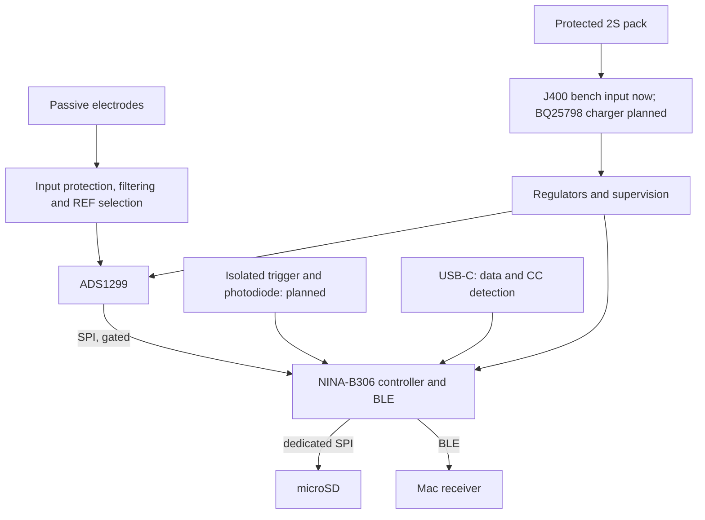

# EEG PCB design guide

Last updated: 2026-11-08 • Current schematic: Rev C4 (Step 7) • Status: bench schematic candidate, no layout

This guide describes the design as it currently stands: what is being built, how each part works and why the present choices were made. It assumes familiarity with laboratory measurement but not with specialist PCB or analogue-circuit design. The rationale behind individual choices, and the conditions for revisiting them, are recorded in [decision_log.md](decision_log.md). The step-by-step reviews in [reviews/](reviews/) hold the detailed calculations, manufacturer references and the history of how each subsystem reached its current form. The current status and open release gates are summarised in the [README](../README.md).

Throughout this guide, *drawn* means present in the schematic and checked for connectivity; it does not mean simulated, built or measured. Nothing in the design has been physically tested, and the board is not released for fabrication or for connection to a person.

## 1. Purpose and boundaries

The board is a portable EEG acquisition system for long-term electrode research, in particular for comparing PEDOT:PSS-based electrodes with commercial Ag/AgCl electrodes. Adjacent electrode pairs can be recorded simultaneously, which reduces the temporal differences between recordings; electrode position and reference choice still affect the comparison.

The system records locally to microSD whilst streaming over BLE to an M2 Mac. It must preserve raw measurements, electrode and montage metadata and accurate event timing, so that electrode performance can be evaluated without being confounded by failures of the recording system.

| Target | Current meaning |
|---|---|
| Eight channels | Eight simultaneous differential measurements, not eight independent grounds |
| 24 bit, 1 kS/s | Raw conversion format and sampling rate; not a claim of 24 noise-free bits |
| 0.1–100 Hz | Intended analysis band, not a completed analogue filter specification |
| Passive electrodes | No powered buffer at each electrode |
| 24 h | Continuous local recording plus BLE; a target, not demonstrated endurance |
| BLE range | ≈ 2 m to the Mac |
| Events | Isolated external trigger and photodiode timing, principally for visual ERP |
| PCB and enclosure | Four layers; ≈ 100 × 70 × 30 mm enclosure target |
| Budget | €500 including VAT, assembly, enclosure and storage; batteries and shipping excluded |

## 2. What exists now

Rev C4 is a 14-page KiCad project ([hardware/EEG_RevC.kicad_sch](../hardware/EEG_RevC.kicad_sch)) generated by [hardware/scripts/build.py](../hardware/scripts/build.py). It integrates the ADC and electrode inputs, the Step 4 power and supervision circuitry, the NINA-B306 controller module, USB-C data and current detection, SWD debug access and a microSD socket.

| Sheet | What it contains |
|---|---|
| ads1299 core | U1 (ADS1299), its supply pins, VREF and VCAP capacitors |
| Electrode inputs 1–4 and 5–8 | Electrode connectors, series resistors, TVS protection, differential capacitors and REF-selection jumpers |
| Reference selection and retained BIAS network | Shared REF electrode and the BIAS feedback network |
| analog | LT3045 analogue regulator (5.050 V) |
| supervision | TPS389001 voltage supervisors for analogue, digital, SYS and pack |
| reset logic | Hardware AND-gating of ADC reset and analogue enable |
| ADC startup gating and SPI connections | Output-enable buffers that hold ADC control lines low until power is valid |
| NINA-B306 controller and reserved interfaces | U300 module and its pin allocation |
| SWD / buttons / hardware service inhibit | J300 debug connector, reset, recovery and record buttons, service interlock logic |
| USB-C device connector / ESD / CC current detection | J310, TUSB320LAI and USB ESD protection |
| Digital 3V3 rail and bench power boundary | TPS62162 digital converter and the temporary J400 bench input |
| microSD SPI and shutdown test access | J420 socket, series resistors, pull-ups, card detect and test pads |

Global net labels connect the sheets electrically, so two matching labels on different pages are connected without a drawn wire between them. Rendered SVG views of every sheet are in [hardware/preview/](../hardware/preview/).

The design does not yet contain the battery charger, the isolated trigger and photodiode front ends, the mechanical service interlock or any acquisition firmware. There is no PCB layout.

## 3. Signal and power architecture

BIAS also feeds a controlled common-mode voltage back towards the body through its dedicated electrode and resistor network. The diagram omits that feedback path for clarity.

## 4. What an EEG input measures

A differential channel measures the voltage difference between two terminals:

\[
V_{diff}=V_P-V_N,\qquad V_{CM}=\frac{V_P+V_N}{2}.
\]

The EEG waveform is part of the differential voltage. Both electrodes can also pick up a much larger shared mains-related voltage, which the amplifier ideally rejects. Real circuits have finite common-mode rejection, and mismatched electrode impedances or input components convert part of the shared interference into differential error.

An electrode is not an ideal wire. A useful model includes a DC half-cell potential and a frequency-dependent interface impedance, often represented by resistive and capacitive elements. Dry or changing contacts show high impedance, motion-related voltage changes and variable offsets. A design can therefore have low noise with shorted inputs and still perform poorly with real electrodes.

### REF, BIAS and GND are different

| Term | Role |
|---|---|
| REF electrode | A measurement terminal shared by the channels that select it |
| BIAS electrode | A driven feedback connection that controls body and input common-mode voltage |
| Circuit GND | Circuit voltage reference and return node; not protective earth |
| ADC voltage reference | Internal ≈ 4.5 V scale used by the converter; not the REF electrode |

For a bipolar channel the negative terminal goes to its own electrode; for a shared-reference channel it goes to REF. Jumpers JP1–JP8 make this selection per channel (1–2 bipolar, 2–3 shared REF). Fit only one shunt per jumper, change it with the board powered off and the electrodes disconnected, and record every montage.

## 5. Gain and offsets

The programmable gain amplifier increases small differential signals before conversion. Higher gain makes better use of the converter range but also amplifies electrode offsets and artefacts. For the 4.5 V internal reference, the ideal differential full-scale range is:

\[
V_{FS}=\pm\frac{V_{REF}}{G}.
\]

| Gain | Differential full scale |
|---:|---:|
| 6 | ±750 mV |
| 12 | ±375 mV |
| 24 | ±187.5 mV |

A 300 mV electrode offset would already exceed the gain-24 range, so gain 12 is the initial working target, subject to measured offsets. The PGA common-mode limits must also be respected: each input needs ≈ 0.2 V plus half the amplified differential swing of headroom from each analogue rail. Being inside differential full scale alone is insufficient.

Acquisition is DC-coupled and the analysis high-pass is applied digitally. A digital filter can remove an offset only if the hardware acquired it without clipping; it cannot recover a waveform that saturated before conversion. Raw DC-coupled acquisition and careful offset and headroom testing therefore belong together.

## 6. Electrode input network

Each of the 16 input legs follows the same path:

electrode → 47 kΩ → 47 kΩ → TPD2E2U06 TVS node → 4.7 kΩ → ADS1299 input

A 220 pF C0G capacitor connects the positive and negative ADC inputs of each channel. The resistors are 0.1 % 0805 parts; pulse-rated exact part numbers remain to be selected. Every REF branch passes through its own copy of this network.

### Protection

The TVS sits after 94 kΩ of series resistance, so a shorted TVS still leaves that impedance between the electrode and ground. The final 4.7 kΩ limits current into the ADC's internal clamps, since the TVS clamp voltage lies above the ADC rails. The TVS shunts transients to circuit ground; it is not galvanic isolation. Protection components also add leakage: TI specifies 10 nA maximum at 2.5 V, and 10 nA through 94 kΩ plus a 100 kΩ electrode shifts that leg by ≈ 1.94 mV. A leakage change of 10 pA across the same path gives ≈ 1.94 µV, so removing the static offset does not remove leakage drift.

### Noise

For a resistor at temperature T over a flat bandwidth B:

\[
v_n=\sqrt{4kTRB}.
\]

With independent resistor noise in both legs, the resistor-only contribution over 0.1–100 Hz at 300 K is ≈ 0.572 µV RMS (0.558 µV before the 4.7 kΩ resistors were added). This excludes electrode, ADC and TVS noise; TVS low-frequency noise is not specified and must be measured.

### Filtering

For independent differential inputs the simple pole is:

\[
f_c=\frac{1}{2\pi(197.4\ \text{k}\Omega+Z_P+Z_N)\,C_{diff}}.
\]

This gives ≈ 3.67 kHz with zero electrode impedance, ≈ 1.82 kHz with two 100 kΩ electrodes and ≈ 329 Hz with two 1 MΩ electrodes. The network is an RF input filter, not a 100 Hz anti-alias filter. The ADC's sinc³ digital filter repeats near the modulator frequency (1.024 MHz), so the external network and the layout must reject high-frequency interference.

### Shared reference coupling

When several channels share one REF electrode, they are electrically coupled through it. With eight channels on a 100 kΩ reference electrode, the linear model in [analyze_inputs.py](../hardware/scripts/analyze_inputs.py) predicts ≈ −37.3 dB coupling between channels at 100 Hz. Raising C_diff to 470 pF worsened this to ≈ −31.0 dB, which is why 220 pF was kept. This coupling is electrical, not physiological, and it matters directly for electrode comparisons. Measurements requiring independent signals should use bipolar selection until the reference distribution is revisited.

The full fault table, manufacturer evidence and acceptance tests are in [reviews/step7_input_protection_review.md](reviews/step7_input_protection_review.md).

## 7. BIAS feedback

The BIAS amplifier uses selected input common-mode information to drive a dedicated electrode towards a controlled voltage. This helps keep the amplifier inputs in range and reduces interference. It is an active feedback loop that includes the amplifier, output resistance, electrode interfaces, the body and cable capacitance.

The candidate network is 1 MΩ in parallel with 1.5 nF in the feedback path and two 499 kΩ series output resistors. Their RC corner is ≈ 106 Hz, but that figure is neither the bandwidth nor the stability margin of the complete loop. The loop has not been simulated or measured with realistic electrode models; this is the subject of Step 8. REF must not be confused with this driven output.

## 8. Sampling, data rate and storage

At 1,000 samples/s the ideal Nyquist frequency is 500 Hz. That does not mean every signal below 500 Hz is represented accurately, or that signals above it are harmless. A delta-sigma converter combines oversampling and digital filtering, and its frequency response, delay and residual aliasing matter for amplitude and ERP timing.

A nominal 24-bit converter provides many codes, but effective resolution is limited by noise, reference stability and the full signal chain. At gain 12, a 750 mV total ideal range divided by 2²⁴ gives ≈ 44.7 nV per code; this is code spacing, not measurable EEG accuracy.

Each ADC frame carries 24 channel bytes and three status bytes, so the raw stream is 27,000 bytes/s.

**BLE.** The proposed packet carries a 16-byte header plus eight frames, 232 bytes in total. At 125 packets/s this is 29,000 bytes/s, or 232 kbit/s before BLE overhead. Sequence numbers and sample indices reveal missing data. Wireless arrival times are not sample timestamps, and BLE can stall or disconnect, so local recording must continue independently. No device firmware exists yet and Mac throughput has not been measured.

**microSD.** The card sits on its own SPI bus so that card transfers do not occupy the ADC bus. SD writes can stall far longer than their average rate suggests; a 64 KiB RAM queue gives ≈ 1.79 s of capacity at 32 kB/s, and a longer stall must create an explicit gap rather than silently overwriting samples. The record format stores 148 frames per 4096-byte record, with a session UUID, sample index, sequence number and CRC32, so that valid records can be recovered after an incomplete write. Files are preallocated at 1 GiB. Normal data traffic is ≈ 2.39 GB/day. The format is specified in [recording_format_v1.md](recording_format_v1.md) and a tested host-side reference codec is in [host/record_format.py](../host/record_format.py); MCU firmware is not written.

## 9. Power supplies and decoupling

The board assumes a removable protected **2S battery pack**: two Li-ion cells in series, 8.4 V at full charge. Series connection raises voltage; it does not add the cells' ampere-hour ratings. Cell protection and balancing belong to the pack.

An **LDO** regulates by dropping excess voltage, which gives a low-noise analogue supply at the cost of dissipation. A **buck converter** switches energy through an inductor to step voltage down efficiently, but its switching currents require careful placement and return paths.

| Rail | Part | Nominal | Notes |
|---|---|---:|---|
| Analogue (AVDD) | LT3045 LDO | 5.050 V | Calculated envelope 4.937–5.163 V, ≈ 87 mV below the ADS1299 5.25 V ceiling |
| Digital (+3V3) | TPS62162 buck from SYS | 3.3 V | Supplies the module, logic and microSD; 480 mA peak design envelope |
| SYS | J400 bench input today | 6.8–8.4 V | Temporary current-limited bench input until the BQ25798 charger is integrated |

The analogue supply voltage and the internal 4.5 V ADC reference have different jobs. Local decoupling capacitors provide short current paths during rapid load changes; a large capacitor elsewhere cannot replace a small one next to a supply pin, because tracks and vias have inductance. Ceramic capacitance falls under DC bias, so the printed value is not always the effective value. VCAP pins are internal bypass nodes, not auxiliary supply outputs.

**Charging (planned).** A 5 V USB-C source cannot charge an 8.4 V pack directly. The selected architecture is a 5 V-only USB-C sink with TUSB320LAI current detection and a BQ25798 buck-boost charger and power path, with an initial target of 0.5 A at 8.4 V. USB PD is not needed. TUSB320LAI is drawn; the charger is not, and USB VBUS currently has no connection to SYS or the pack.

## 10. Supervision, brownout and shutdown

TPS389001 supervisors monitor the analogue rail, the digital rail, SYS and the pack. Their outputs are combined in hardware: the ADC reset and analogue enable are AND-gated, so a monitored fault holds the ADC in reset independently of firmware. Five SN74LVC1G126 buffers hold the MCU's ADC control outputs disconnected, with pull-downs on the ADC side, until ANALOG_OK, DIGITAL_OK and ANA_ENABLE are all true.

| Monitor | Nominal | Calculated envelope |
|---|---:|---:|
| Analogue reset assertion | 4.830 V | 4.764–4.896 V |
| Digital reset assertion | 3.151 V | 3.110–3.192 V |
| SYS analogue inhibit | 5.773 V | 5.693–5.853 V |
| Pack analogue inhibit | 6.1985 V | 6.112–6.285 V |
| Pack early warning (BAT_WARN_OK) | 6.6125 V | 6.520–6.705 V |

These are static calculations, not tested thresholds. The minimum regulator output exceeds the maximum analogue reset release threshold by only ≈ 11 mV, which passes the calculation but leaves a narrow startup margin. The Step 4 review of this margin, dynamic collapse behaviour, restart latching and capacitor qualification was deferred and remains open.

Low-battery shutdown is best effort. BAT_WARN_OK starts a controlled stop: capture halts, the queue drains, the card finishes and files are synchronised where possible. No minimum shutdown interval is guaranteed, because disconnecting the pack removes energy immediately, and local bypass capacitors support microsecond transients rather than a final flash flush. The record format is designed for that case.

Energy, rather than battery voltage alone, determines endurance. A 7.4 V, 3 Ah pack holds 22.2 Wh nominal, reduced in practice by cutoff, ageing, temperature and conversion losses. A first estimate is:

\[
P_{pack}\approx V_{pack}I_{analog}+\frac{3.3\,I_{digital}}{\eta_{buck}}+P_{other}.
\]

Average SD and radio current can dominate, so this estimate must be replaced by measurement during real logging and streaming.

## 11. Controller, programming and service

The controller is a u-blox **NINA-B306-00B**, an open-CPU nRF52840 module with an integrated PCB antenna, supplied at 3.3 V. Its 35 GPIO allocations are listed in [hardware/controller_pinmap.csv](../hardware/controller_pinmap.csv). The ADC and the microSD each have a dedicated SPI controller; DRDY, trigger and photodiode edges are reserved for hardware timestamp capture.

SPI uses a clock and two data lines between controller and device; chip select chooses the device, and DRDY tells the controller that a fresh frame is ready. Series resistors of 33 Ω to 100 Ω damp fast edges; they are not level shifters or isolation.

**SWD** (J300, a keyed 10-pin Cortex connector) is the initial programming and recovery interface. Its 3.3 V pin is a voltage reference for the probe, not a power input; the board must be powered from its own supply. Reset, recovery and record buttons are drawn, but firmware must configure the reset pin and implement recovery behaviour.

**USB-C** (J310) connects to the module's native USB pins. USB can support configuration and firmware updates only after a suitable bootloader has been installed over SWD. TUSB320LAI tells the source that the board is a sink and reports the advertised current; it does not charge the pack.

**Service boundary.** Recording happens on battery with all service cables absent. USB, SWD and charging are service operations with every electrode disconnected, including REF and BIAS. USB presence, a compatible SWD adapter and an open interlock input each inhibit acquisition through SERVICE_OK. These detectors do not catch every conductive connection (an unpowered USB cable, for example) and do not provide galvanic isolation, so physical disconnection remains the rule. The preferred mechanical interlock, which would prevent USB insertion whilst the electrode harness is attached, is not yet designed.

## 12. Timing for event-related EEG

Three times can differ: when software requests a stimulus, when hardware produces it and when the acquisition system records its marker. A photodiode detects the actual screen change and can reveal display delay and jitter. An isolated trigger can convey an external event whilst keeping electrical grounds separated across a properly designed barrier.

Events should be related to ADC sample indices or a synchronised hardware timer. Sending a marker over BLE and using its arrival time would mix radio latency into physiological timing. The ADC currently runs from its internal oscillator, which is not a calibrated sample clock; drift over long recordings has not been budgeted. The isolated trigger and photodiode circuits are reserved in the pin map but not designed.

## 13. PCB layout concepts

A schematic specifies connectivity; layout determines physical current paths, coupling and manufacturability. A four-layer board allows a continuous reference plane and controlled routing, but does not by itself produce low noise.

Keep sensitive electrode traces short and away from the buck switch node, the SD clock and the antenna. Place bypass components next to their pins. Keep digital return currents out of the analogue input area. Preserve a return path beneath fast signals; indiscriminate ground-plane splits can worsen interference. The module's antenna keepout is a physical constraint on placement and enclosure.

Before layout, the footprints need a dimensional audit. The NINA-B306 land pattern needs a matching custom footprint, since its exposed ground groups are symbolic in the schematic, and the microSD socket's shell pads are named differently in the KiCad 10 library (see the README open items). No stack-up or routing has been selected.

## 14. Validation and limits

[hardware/rebuild.sh](../hardware/rebuild.sh) regenerates the schematic and reruns every check. The current result, in [hardware/checks/validation.md](../hardware/checks/validation.md), is 275 netlist assertions passing and zero ERC errors. The ERC warnings all come from the local KiCad installation lacking a global footprint-library table, not from the circuit. The assertions confirm that the intended connections, values and pin mappings exist, and that circuitry outside the changed area was preserved. They cannot establish low noise, loop stability, safe participant currents, assembly yield or 24 h operation.

The intended progression is schematic review, simulation and corner review where appropriate, layout, bench prototype, measured system validation and then any required participant-use review. Bench work should use an electrode simulator. Battery operation does not preserve isolation once a non-isolated programmer, USB cable or oscilloscope is attached. No IEC 60601 conformity, mains protection or defibrillation protection is claimed.

## 15. Technical references

Manufacturer documents already used in the design (further sources are listed in each review):

- [TI ADS1299](https://www.ti.com/lit/ds/symlink/ads1299.pdf): input limits, conversion, reference, BIAS and startup
- [ADI LT3045](https://www.analog.com/media/en/technical-documentation/data-sheets/3045fa.pdf): analogue regulator
- [TI TPS3890](https://www.ti.com/lit/ds/symlink/tps3890.pdf): voltage supervisors
- [TI TPS6216x](https://www.ti.com/lit/ds/symlink/tps62160.pdf): digital converter
- [TI TPD2E2U06](https://www.ti.com/lit/ds/symlink/tpd2e2u06.pdf): input and USB ESD protection
- [TI TUSB320LAI](https://www.ti.com/lit/ds/symlink/tusb320lai.pdf): USB-C CC detection
- [TI BQ25798](https://www.ti.com/lit/ds/symlink/bq25798.pdf): planned charger and power path
- [u-blox NINA-B3 data sheet, UBX-17052099](https://content.u-blox.com/sites/default/files/NINA-B3_DataSheet_UBX-17052099.pdf): controller module
- [Nordic nRF52840 product specification](https://docs.nordicsemi.com/r/bundle/ps_nrf52840/page/keyfeatures_html5.html): controller peripherals
- [Bleak](https://bleak.readthedocs.io/en/latest/): Mac BLE receiver development

The Rev B package (`EEG_PCB_Step2_ADS1299_Power_RevB.zip`) and the per-step zip packages referenced in the reviews are not held in this folder.
