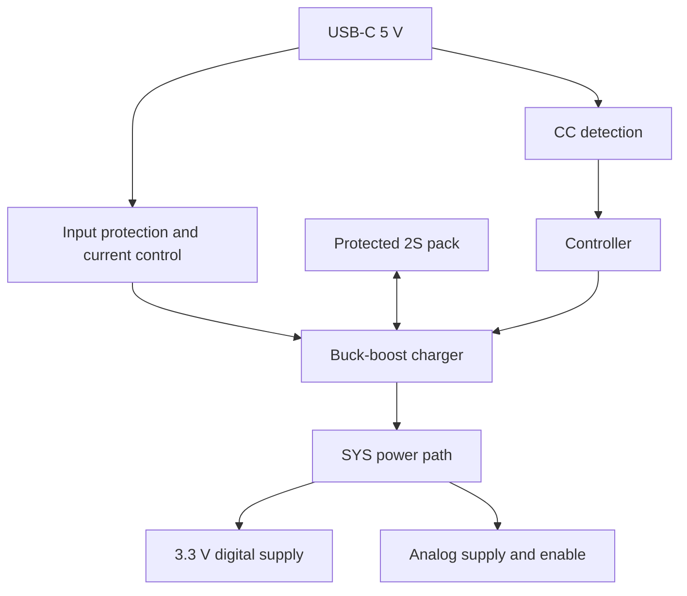

# Rev C architecture — steps 1–3

2026-11-08. Design decisions for the next schematic revision; Rev B hardware unchanged. Manufacturer documentation checked online. This is an architecture release, not fabrication approval. Review findings remain open until implemented and validated.

## 1. Operating modes and external connections

| Mode | Source | Connections allowed | Required behavior |
|---|---|---|---|
| Battery recording | Protected pack | Electrodes, BLE, passive photodiode; qualified isolated trigger | USB, SWD, UART cables and grounded instruments absent; SD and BLE run concurrently |
| USB configuration/update | USB, pack optional | Mac USB-C; electrodes disconnected | Analog acquisition inhibited; configure/export/update; safe removal of storage before USB file access |
| Charging | USB plus pack | USB-C charger; electrodes disconnected | ADC off; controller monitors charge state and source budget |
| Bench development | Pack simulator or intended USB power path | SWD/scope/simulator; no person | Never parallel uncontrolled power sources; SWD target reference is sense only |
| Soft off | Pack; USB may initiate service | No human connection during USB service | Recording rails off; charging management remains available when USB attached |
| Fault/recovery | Available valid source | Service connections only | Default charging disabled and ADC held inactive until configuration passes |

All external electrodes, including REF and BIAS, must disconnect for service. A physical connector/cover arrangement that prevents USB insertion while the electrode harness is attached is the preferred enclosure requirement. A presence switch can inhibit operation but is not galvanic isolation. If the mechanical interlock cannot be realized, revisit the interface architecture before participant-use release. Debug access belongs behind the service cover. Bare photodiode input accepts only a passive sensor; powered external equipment belongs on the isolated trigger interface. microSD handling is a service action.

USB insertion hardware-inhibits acquisition, with firmware closing files when possible. This is a recording-integrity measure, not patient isolation. USB removal never automatically resumes participant recording: require explicit start and electrode checks. Battery removal during recording is an abrupt-power-loss test case, not a guaranteed clean shutdown.

## 2. Controller selection and allocation

Selected design baseline: **u-blox NINA-B306-00B**, open-CPU nRF52840 module with integrated PCB antenna. Use this exact variant, not NINA-B31 firmware variants or the -01B variant. Supply VCC and VCC_IO together from 3.3 V. Manufacturer operating range is 1.7–3.6 V; footprint and antenna integration still require the system integration manual before layout. Availability and price are not yet verified.

Selection rationale: integrated RF implementation, exposed USB and debug signals, sufficient GPIO, and an existing nRF52840 software ecosystem. This reduces RF implementation work while retaining custom acquisition firmware. Module certification does not certify the completed instrument.

The accompanying controller_pinmap.csv is the proposed assignment. Module-pad to Nordic-pin identities were checked against UBX-17052099 R15, Table 7. There are 33 unique assigned GPIOs. Keep high-speed clocks away from pads identified as radio-sensitive. Slow control outputs use standard drive and no PWM. Pads 8 (P1.00/SWO), 28/29 (NFC), and 38–41 remain reserved; no external QSPI memory is allocated.

| Dedicated connection | Module pad | Purpose |
|---|---:|---|
| VCC_IO / VCC | 9 / 10 | Same 3.3 V rail |
| SWDCLK / SWDIO | 11 / 15 | Initial programming and recovery |
| RESET_N | 19 | Hardware reset; configure Nordic reset function |
| USB VBUS | 31 | Protected USB 5 V only |
| USB D+ / D− | 54 / 55 | Native USB device interface |
| Ground | 6,12,14,26,30,53 and exposed ground pads | Verify all exposed pads against package drawing |

Use a keyed Cortex 10-pin debug connector: 1 target reference, 2 SWDIO, 3 ground, 4 SWCLK, 5 ground, 6 reserved SWO, 7 key, 8 unused, 9 ground/detect, 10 reset. No programmer power injection. Include a dedicated recovery button. Parallel trace is disabled because its alternate pins are assigned elsewhere.

Peripheral resource plan: SPIM2 for ADC; SPIM3 for SD; TWIM0 for power devices; TIMER2 with three capture channels for DRDY, isolated trigger and photodiode using GPIOTE/PPI. These are firmware reservations, to be checked against the selected SDK/BLE configuration and Nordic errata during firmware implementation. The radio stack may reserve other resources. USB uses native USBD. At 4 MHz, a 216-bit ADC frame takes 54 microseconds excluding overhead. Separate SPI buses prevent SD busy time from directly occupying the ADC bus. Reserve 64 KiB initially for recording buffers: about 2.4 s at 27 kB/s before metadata; prove the final RAM/linker budget with BLE and USB enabled. BLE and SD endurance remain unmeasured.

## 3. Battery and USB-C architecture

Selected architecture: **5 V-only USB-C sink, TUSB320LAI CC controller, BQ25798 buck-boost charger/power path, protected 2S pack**. No PD negotiation or OTG/source operation in Rev C. D+/D− belong to the MCU; do not directly parallel them with charger detection circuitry. Disable charger automatic D+/D−/HVDCP detection in the controlled configuration; review its reset behavior and leave unused detection inputs as specified in the detailed schematic.

Use SYS for system loads, BAT for the pack. Replacing the old battery-to-regulator path is necessary; adding a charger beside the old power path is insufficient. Separate RUN control from charging so the unit can charge with recording off. Recalculate UVLO and reset gating in step 4; the Rev B after-diode thresholds cannot simply be transferred to charger SYS.

Design parameters (selected targets are not measured performance):

| Item | Baseline / status |
|---|---|
| Pack | Conventional 4.2 V/cell Li-ion, 2S, approximately 3 Ah planning capacity; exact pack open |
| Protection | Independent cell over/undervoltage, overcurrent/short protection and appropriate balancing required |
| Temperature | Pack-mounted thermistor required; resistance/B curve and TS network chosen together after pack selection |
| Charge endpoint | 8.4 V target; include charger regulation tolerance in pack qualification |
| Charge current | 0.5 A initial target, reduced as necessary by available USB power and thermal/pack limits |
| Charger PROG | 6.04 kΩ, 1% target selects 2S/1.5 MHz; confirm actual BOM tolerance |
| Charge default | CE hardware held inactive until pack/temperature/source/configuration checks pass; no floating CE |
| USB mode | Sink only; no PD, no OTG; CC controller provides terminations—do not add duplicate Rd resistors |
| CC supply/control | 3.3 V; PORT low; I2C mode with ADDR low (0x47); EN_N low when enabled |
| Source limit | Never infer 3 A from connector shape. Read CC advertisement and enforce a conservative limit including all USB branches |
| Initial legacy USB | Keep total pre-enumeration demand within applicable USB limit; charging disabled until authorized budget is known |

A source advertising 1.5 A is sufficient for the 0.5 A charge target under the planning budget: 8.4×0.5 = 4.2 W to battery; at assumed 85% efficiency plus 0.5 W service load, approximately 5.44 W or 1.09 A at 5 V. Efficiency is an assumption. A 500 mA source cannot sustain that target: reduce charging or disable it. A full 3 Ah recharge takes at least 6 h at 0.5 A, plus the constant-voltage phase and losses.

A 22.2 Wh nominal pack with 25% reserved/unusable energy leaves 16.65 Wh: 24 h requires average battery power below about 0.694 W. Retaining the existing 0.50 W planning load gives approximately 33 h mathematically, not a runtime guarantee. Charger pass-path loss, cutoff, SD bursts, aging and temperature require measurements.

Critical implementation requirement: startup must not rely on firmware already running. Use a conservative hardware input-current ceiling and default-inactive CE; change the ceiling only after source qualification. Account for module VBUS and CC/protection consumption outside the charger input measurement. Deeply discharged/absent-pack bootstrap, USB suspend, detach, source-current changes and watchdog resets must be tested. CC dead-battery terminations allow attachment, but do not by themselves solve system startup power. These detailed circuits belong to steps 4–5 and remain release blockers.

The present 2-pin battery connector must be replaced by a keyed connector supporting pack +, − and thermistor, with optional pack-ID/interlock contacts. A cell midpoint is not required on the main PCB if protection/balancing is entirely inside the specified pack. Exact battery, connector, charger passives, protection switches and thermal design are intentionally pending component-level implementation.

## Verified sources and boundaries

- u-blox NINA-B3, UBX-17052099 R15: https://content.u-blox.com/sites/default/files/NINA-B3_DataSheet_UBX-17052099.pdf — module choice, supply, pad mapping, radio-sensitive pins, USB/debug.
- TI BQ25798, SLUSDV2C: https://www.ti.com/lit/ds/symlink/bq25798.pdf — buck-boost/power path, Table 7-1 strap, CE and ILIM_HIZ behavior. Do not assume all reset defaults match our selected charge policy.
- TI TUSB320LAI, SLLSEQ8D: https://www.ti.com/lit/ds/symlink/tusb320lai.pdf — sink selection, source-current detection, address, dead-battery behavior and back-power precautions. Integrated CC termination avoids separate Rd resistors.

All three sources were retrieved on 2026-11-08. Source statements and our design targets are separated above. Final capacitor/inductor values, pin-level charger wiring, power-control logic and module antenna geometry must be verified from the relevant manufacturer sections when drawn; they are not approved by this architecture document.

Steps 1–3 are complete at architecture level. R01/R02/R05/R06/R09/R10 now have a defined implementation direction; none is marked electrically verified. Next: step 4 supply accuracy, reverse discharge, reset and UVLO redesign, followed by integration of these selected blocks.
